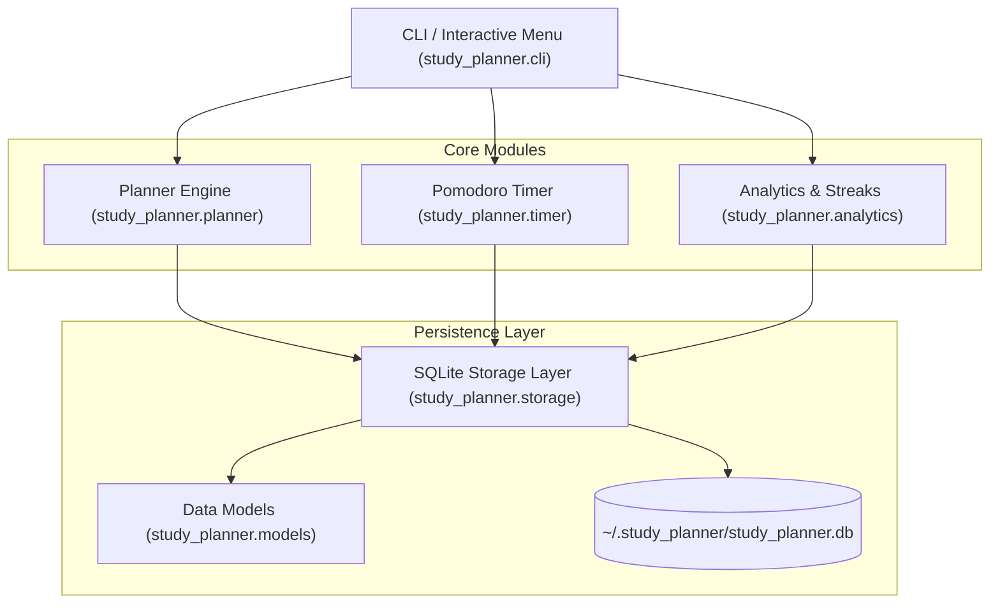

# 📚 StudyFlow — Intelligent Terminal Study Planner & Productivity Suite

<p align="center">
  
  
  
  
  
</p>

**StudyFlow** is an intelligent, developer-friendly study planner and productivity engine designed for students, self-learners, and engineers. It combines **smart daily schedule optimization**, an integrated **Pomodoro focus timer**, **SM-2 spaced repetition review**, and **streak analytics** into a sleek terminal experience.

---

## ✨ Features

- 🎯 **Automated Daily Study Schedule**: Balances task priority, deadlines, and weekly course targets to generate realistic daily schedules without burnout.
- 🍅 **Built-in Pomodoro Timer**: Live progress bar, audio cues, pause/resume, and automatic session recording into local SQLite storage.
- 🧠 **SuperMemo SM-2 Spaced Repetition**: Keep track of key concepts and flash topics with adaptive intervals based on recall difficulty.
- 📊 **Visual Analytics & Streak Tracker**: Track your study streak, daily hours with ASCII bar charts, and weekly target progress per subject.
- ⏳ **Exam Countdown & Alerts**: Stay ahead of deadlines with automatic urgency calculations and exam alerts.
- 💾 **Zero-Config Persistent Storage**: Uses SQLite with zero configuration required, with full JSON export and import for seamless backups.
- 🖥️ **Dual Interface**: Use either full **CLI commands** for scripting and fast entry, or launch the **interactive terminal menu**.

---

## 🏗️ Architecture



---

## 🚀 Quick Start

### 1. Installation

Clone the repository and install dependencies:

```bash
git clone https://github.com/your-username/study-planner.git
cd study-planner

# Create virtual environment (optional but recommended)
python -m venv venv
# On Windows:
venv\Scripts\activate
# On Linux/macOS:
source venv/bin/activate

# Install package in editable mode with Rich terminal output
pip install -e .
```

> **Note**: StudyFlow runs out of the box using only the Python Standard Library! Installing `rich` (`pip install rich`) enables vibrant colored tables, panels, and progress bars.

---

## 💻 Usage

### 🎮 Option 1: Interactive Menu Mode

Simply run without arguments or use the `menu` command to launch the interactive prompt:

```bash
study-planner
# or
python -m study_planner
```

```text
=============================================
       📚 STUDYFLOW INTERACTIVE PLANNER
=============================================
1. 📅 View Today's Optimized Study Plan
2. ⏱️  Start Pomodoro Focus Timer
3. 📋 Manage Tasks (List, Add, Complete)
4. 📖 Manage Subjects / Courses
5. 🧠 Spaced Repetition Flash Reviews
6. 📊 Analytics, Streaks & Progress
7. 💾 Export / Backup Data
0. 🚪 Exit
---------------------------------------------
```

---

### ⚡ Option 2: Command Line (CLI) Reference

#### 📖 Subjects & Courses

```bash
# Add a subject with weekly target hours and exam date
study-planner subject add "Data Structures" --hours 6.0 --exam 2026-11-15 --color green
study-planner subject add "Machine Learning" --hours 8.0 --exam 2026-12-01 --color cyan

# List all tracked subjects
study-planner subject list

# Delete a subject by ID
study-planner subject delete 1
```

#### 📋 Tasks & Assignments

```bash
# Add a task with deadline, priority, and estimated hours
study-planner task add "Graph Algorithms HW" --subject "Data Structures" --due 2026-10-25 --priority urgent --hours 2.5
study-planner task add "Read Chapter 3: Trees" --subject "Data Structures" --priority medium --hours 1.5

# List pending tasks
study-planner task list

# Mark a task as done
study-planner task done 1

# Delete a task
study-planner task delete 2
```

#### 📅 Generating Today's Optimized Plan

```bash
# Generate plan for up to 5 hours of study today
study-planner plan --hours 5.0
```

*Output includes urgent task prioritization, exam countdowns, smart recommendations, and due spaced reviews.*

#### 🍅 Pomodoro & Focus Timer

```bash
# Run a 25-minute Pomodoro session logged against a subject
study-planner timer --minutes 25 --subject "Data Structures" --notes "Practicing Dijkstra's Algorithm"
```

#### 🧠 Spaced Repetition (SuperMemo SM-2)

```bash
# Add a concept for spaced review
study-planner review add "Binary Search Edge Cases" --subject "Data Structures"

# View topics due today
study-planner review due

# Score your recall after reviewing (1 = Forgot completely, 5 = Perfect recall)
study-planner review practice 1 4
```

#### 📊 Study Analytics & Streak Tracking

```bash
study-planner stats
```

Output preview:
```text
=== Study Analytics & Dashboard ===
🔥 Study Streak:        3 day(s)
⏱️  Total Study Time:    12.5 hours across 18 sessions
✅ Task Completion:     8/10 (80.0%)
📚 Active Subjects:     3

📅 7-Day Study Activity:
Mon (10-15): ■■■■■■■                   2.0h (120m)
Tue (10-16): ■■■■■■■■■■                3.0h (180m)
Wed (10-17): ■■■■■                     1.5h (90m)
Thu (10-18): ■■■■■■■■■■■■■             4.0h (240m)

🎯 Weekly Subject Targets:
  ✅ Data Structures     6.5h / 6.0h (100.0%)
  ⏳ Machine Learning    4.0h / 8.0h (50.0%)
```

#### 💾 Export & Import

```bash
# Export all subjects, tasks, reviews, and logs to JSON
study-planner export --output my_backup.json

# Import from a backup
study-planner import my_backup.json
```

---

## 🧪 Running Tests

StudyFlow comes with full unit tests covering models, storage, the SM-2 algorithm, and streak analytics:

```bash
# Using standard Python unittest
python -m unittest discover -s tests -v

# Or using pytest (if installed)
pytest -v --cov=study_planner
```

---

## 📁 Repository Structure

```text
study-planner/
├── .github/
│   └── workflows/
│       └── ci.yml              # Multi-OS & multi-version CI test matrix
├── study_planner/
│   ├── __init__.py             # Package exports & version
│   ├── __main__.py             # Entry point for `python -m study_planner`
│   ├── models.py               # Subject, Task, StudySession, SpacedReview models
│   ├── storage.py              # SQLite storage layer with context managers
│   ├── planner.py              # Schedule optimization & SM-2 algorithm
│   ├── timer.py                # Pomodoro timer with terminal progress bar
│   ├── analytics.py            # Streak calculation & ASCII charts
│   ├── cli.py                  # CLI argument parsing & rich formatting
│   └── interactive.py          # Interactive terminal menu (REPL)
├── tests/
│   ├── __init__.py
│   ├── test_models.py
│   ├── test_storage.py
│   ├── test_planner.py
│   └── test_analytics.py
├── .gitignore                  # Clean Python, IDE, & DB exclusions
├── LICENSE                     # MIT License
├── pyproject.toml              # Modern PEP 518/621 build configuration
├── requirements.txt            # Minimal runtime dependencies
├── requirements-dev.txt        # Development & testing tools
└── README.md                   # Project documentation
```

---

## 🤝 Contributing

Contributions, issues, and feature requests are welcome!

1. Fork the Project
2. Create your Feature Branch (`git checkout -b feature/AmazingFeature`)
3. Commit your Changes (`git commit -m 'Add some AmazingFeature'`)
4. Push to the Branch (`git push origin feature/AmazingFeature`)
5. Open a Pull Request

---

## 📄 License

Distributed under the MIT License. See [`LICENSE`](LICENSE) for more details.
